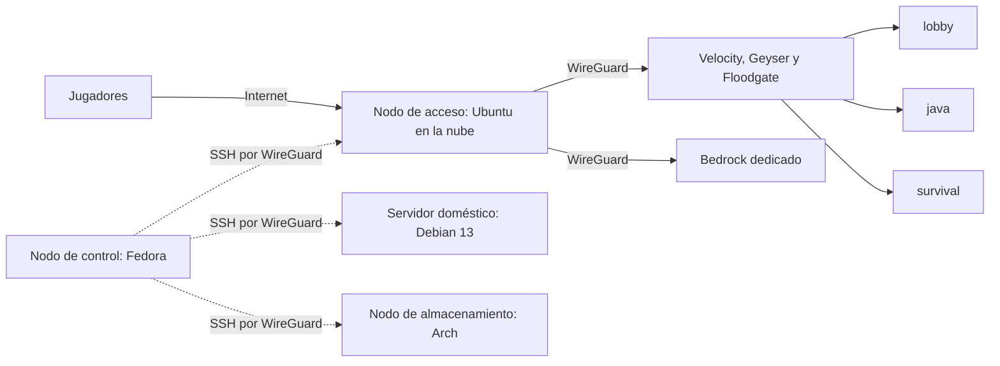

# Infraestructura de servidores Minecraft con Podman rootless, WireGuard y seguridad por capas

Laboratorio de infraestructura diseñado para alojar servidores de Minecraft (Java y Bedrock, con juego cruzado) mediante **contenedores Podman rootless administrados con Quadlet y systemd**. La infraestructura utiliza una **red privada WireGuard de cuatro nodos** y una instancia en la nube como **punto de acceso seguro**.

El proyecto busca poner en práctica conocimientos de administración de sistemas, redes y seguridad informática mediante principios como el mínimo privilegio, la segmentación de servicios, la defensa en profundidad y la validación de cada medida de seguridad. Todo ello acompañado de documentación técnica clara y reproducible.

> **Estado:** proyecto en desarrollo. La sección Estado del proyecto distingue entre las funciones implementadas y verificadas y las que aún están pendientes. Los nombres de los equipos, las direcciones IP públicas y otros identificadores sensibles se han omitido o reemplazado.

---

## Qué demuestra este proyecto

- **Administración de Linux:** trabajo con Debian, Ubuntu, Fedora y Arch Linux.
- **Redes y conectividad:** implementación de VPN con WireGuard, cortafuegos en tres capas (nube, nodo de acceso y servidor), reglas DNAT y NAT, y diagnóstico de tráfico mediante `tcpdump`.
- **Contenedores sin privilegios:** uso de Podman rootless, Quadlet y systemd, cuentas de servicio sin acceso a `sudo`, configuración de subuid/subgid y administración de cgroups v2.
- **Seguridad informática:** aplicación del principio de mínimo privilegio, reducción de la superficie de exposición, gestión de secretos, análisis de amenazas y validación de controles de seguridad.
- **Documentación técnica:** registro de configuraciones, comandos, pruebas, problemas encontrados y soluciones aplicadas.

---

## Arquitectura



Todos los contenedores se ejecutan en el servidor doméstico. El único equipo con exposición pública es el nodo de acceso, que mantiene la conectividad mediante WireGuard. El servidor doméstico no publica servicios directamente en internet.

Más detalles en [docs/architecture.md](docs/architecture.md).

---

## Decisiones de diseño y seguridad

| Decisión | Justificación |
| --- | --- |
| Acceso SSH únicamente mediante WireGuard, sin autenticación por contraseña ni acceso directo como root, con `AllowUsers` | Evitar la exposición de servicios de administración a internet |
| Reglas UFW basadas en interfaz y dirección IP de origen | Aplicar el principio de mínimo privilegio en cada nodo |
| Podman rootless con una cuenta de servicio sin `sudo`, contraseña ni acceso SSH | Reducir el impacto de una posible vulneración de un contenedor sobre el sistema anfitrión |
| Quadlets administrados por root | Impedir que la cuenta de servicio modifique sus propias definiciones de contenedores |
| Redes de contenedores independientes (`mc`, `monitoring`) | Separar los servicios y limitar la comunicación entre ellos |
| Backends Java sin puertos publicados y accesibles únicamente mediante el proxy | Evitar la exposición directa de los servidores que utilizan `online-mode=false` |
| Reenvío moderno de Velocity con un secreto compartido | Proteger la comunicación entre el proxy y los servidores backend |
| Límites de memoria por contenedor | Evitar que un servidor consuma todos los recursos disponibles del host |
| Cortafuegos en tres capas: nube, nodo de acceso y servidor | Aplicar defensa en profundidad y facilitar el diagnóstico de problemas de red |

Más información en [docs/security.md](docs/security.md).

---

## Estado del proyecto

### Implementado y verificado

- Red privada WireGuard de cuatro nodos, con reglas UFW basadas en interfaz y dirección IP de origen.
- Acceso SSH restringido al túnel WireGuard. Los escaneos internos con Nmap únicamente detectan el puerto SSH.
- Podman 5.4 rootless integrado con Quadlet y systemd. Inicio automático de los servicios comprobado después de reiniciar el servidor.
- Velocity configurado con reenvío moderno y servidores Paper detrás del proxy (`java`, `survival` y `lobby`).
- Geyser y Floodgate con NetherNet para habilitar el juego cruzado entre Minecraft Java y Bedrock.
- Servidor dedicado de Minecraft Bedrock con NetherNet.
- Reenvío de puertos TCP y UDP mediante el nodo de acceso, con pruebas de conectividad de extremo a extremo.
- Defensa del borde en el nodo de acceso: límites de conexiones y de ritmo por IP con nftables, y bloqueo automático con CrowdSec y su lista comunitaria. Detalle en [docs/edge-defense.md](docs/edge-defense.md).

### Pendiente de implementación

- **Monitoreo y alertas:** Prometheus, Grafana y Alertmanager.
- **Copias de seguridad:** respaldos cifrados con pruebas de restauración.
- **Defensa del borde (continuación):** recuperar la IP real del jugador mediante PROXY protocol.
- **Control del tráfico saliente:** filtrado de las conexiones iniciadas desde los contenedores.
- **Endurecimiento de SSH:** escucha exclusiva en la IP del túnel.
- **Exposición pública gradual:** habilitación progresiva de los servicios, con pruebas de seguridad en cada etapa.

Como continuación, un segundo proyecto se centrará en la defensa y la auditoría de la infraestructura en tiempo real.

Hoja de ruta completa en [docs/roadmap.md](docs/roadmap.md).

---

## Lecciones aprendidas

Algunos de los problemas técnicos más relevantes encontrados durante el desarrollo:

1. **DNS interno de Podman:** los registros pueden quedar desactualizados después de un reinicio. Comparar la resolución DNS desde el host y desde el contenedor permite identificar dónde se encuentra el problema.
2. **Compatibilidad de Java:** la versión de Java necesaria depende de la versión de Minecraft. Es importante seleccionar una imagen compatible con los requisitos del servidor.
3. **Reglas NAT de UFW:** las reglas pueden duplicarse después de cada recarga si el bloque de configuración no comienza con `-F`.
4. **Diagnóstico de firewalls:** cuando existen tres capas de filtrado, es necesario revisar cada una por separado mediante contadores de paquetes y capturas con `tcpdump`.
5. **Compatibilidad de NetherNet:** la implementación moderna para Bedrock requiere tráfico TCP y UDP en el mismo puerto en ambos extremos. Las pruebas diseñadas exclusivamente para RakNet no son suficientes.

Las once lecciones documentadas, con sus respectivos síntomas, causas y soluciones, se encuentran en [docs/lessons-learned.md](docs/lessons-learned.md).

---

## Estructura del repositorio

```text
README.md
_config.yml
docs/
├── architecture.md
├── network-and-firewall.md
├── edge-defense.md
├── security.md
├── users-and-permissions.md
├── podman-quadlet.md
├── testing-log.md
├── lessons-learned.md
└── roadmap.md

quadlets/
└── Definiciones de contenedores y redes
    (ejemplos sin información sensible)
```

---

## Tecnologías utilizadas

- **Sistemas operativos:** Debian 13, Ubuntu, Fedora y Arch Linux.
- **Redes y seguridad:** WireGuard, UFW, nftables, iptables, NAT y CrowdSec.
- **Contenedores:** Podman 5.4 rootless, Quadlet y systemd.
- **Minecraft:** Velocity, Paper, Geyser, Floodgate y Bedrock Dedicated Server.
- **Diagnóstico y administración:** tcpdump, Nmap y SSH.

---

**Proyecto en desarrollo.** La infraestructura se amplía y documenta progresivamente, priorizando la seguridad, la estabilidad y la reproducibilidad de cada implementación.
